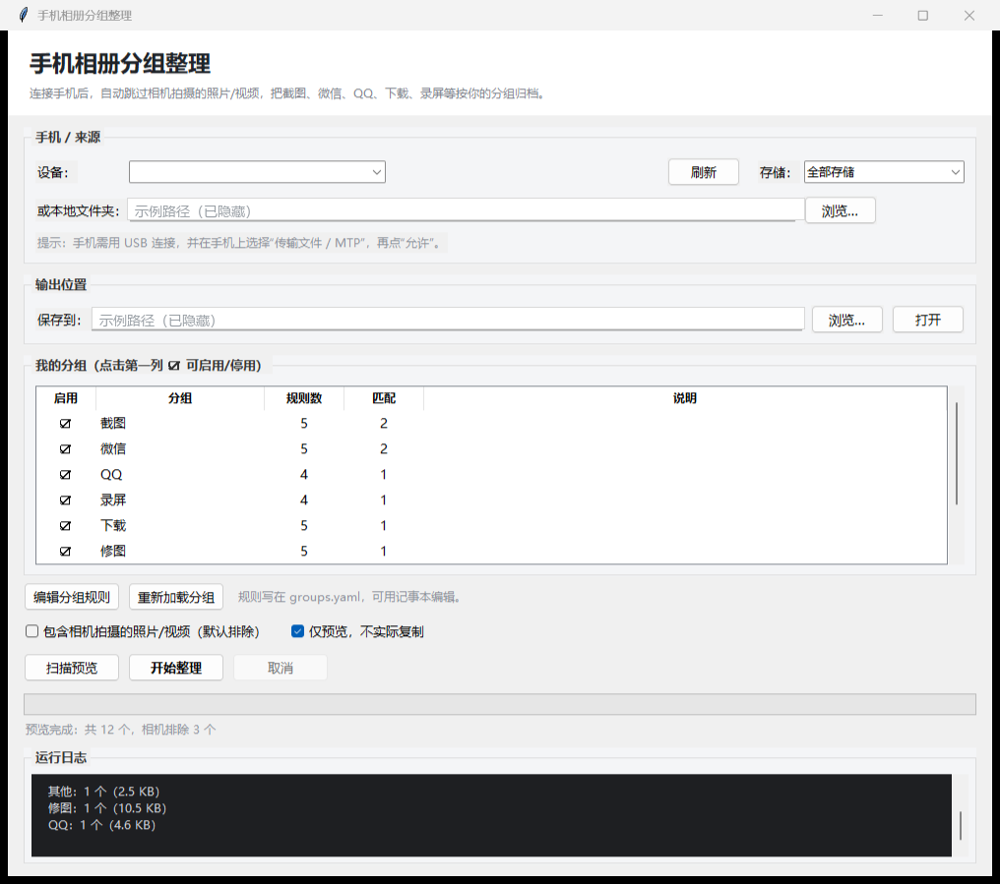

# 手机相册分组整理

插上手机，自动跳过“相机拍摄”的照片和视频，把剩下的（截图、微信、QQ、下载、录屏、修图……）
按你自己预设的分组复制到电脑。还支持本地 AI 识别：**二次元**（动漫/卡通/coser）和 **梗图**（meme/表情包）。

> 手机端只读，不会删除、移动或修改手机里的任何文件。



---

## 它解决什么问题

手机相册里混着几类东西：

- 自己用相机拍的（DCIM/Camera）—— **你不想整理它们**
- 截图、微信保存的图、QQ 图片、浏览器下载、录屏、修图 App 的导出……

这个工具只处理第二类，并按照 `groups.yaml` 里的分组规则归档到电脑。

## 快速开始

1. 手机用 USB 线连电脑。
2. 手机上弹出提示时选择 **“传输文件 / MTP”**，并点 **“允许”**。
3. 双击 `启动.bat`。
4. 选择输出位置（默认是程序目录下的 `整理结果`）。
5. 想按内容分“二次元 / 梗图”的话，勾选 **“内容识别（二次元/梗图）”**。
6. 点 **扫描预览**，看看每个分组会收到多少文件。
7. 确认无误后，取消勾选 **“仅预览，不实际复制”**，点 **开始整理**。

整理过程中不要拔线；大视频会比较慢，这是 MTP 的限制。

> 本机已经装好运行依赖（Python + pywin32 + Pillow + PyYAML）。
> 如果换一台电脑，先在程序目录执行一次：`python -m pip install -r requirements.txt`。

## 输出结构

```
   整理结果/
   ├── 截图/
   ├── 微信/
   ├── QQ/
   ├── 录屏/
   ├── 下载/
   ├── 修图/
   ├── 文档扫描/
   ├── 二次元/
   ├── 梗图/
   ├── 视频/
   ├── 其他/
   ├── 整理报告-20261112-170000.csv
   └── .phonesort/          ← 增量记录，别删（删了会重新导入一遍）
```

每个分组里默认保留原文件名。想按日期分二级目录，把 `groups.yaml` 里的
`options.subfolder` 改成 `"{year}/{month}"` 即可。

## 自定义分组

分组规则都在 `groups.yaml`，用记事本就能改。一条规则示例：

```yaml
  - name: "壁纸"
    enabled: true
    rules:
      - path: "*/Pictures/Wallpaper/*"
      - name: "^wallpaper_"
```

常用匹配字段：

| 字段 | 说明 | 例子 |
| --- | --- | --- |
| `path` | 手机内相对路径，`*` 可跨目录 | `'*/WeiXin/*'` |
| `name` | 文件名正则 | `'^Screenshot_'` |
| `ext` | 扩展名 | `[.jpg, .png]` |
| `media` | 图片或视频 | `video` |
| `exif_software` | 修图软件 | `'美图|Snapseed'` |
| `min_size_kb` / `max_size_kb` | 大小范围 | `300` |
| `min_width` / `max_width` | 宽度范围 | `1080` |
| `date_after` / `date_before` | 日期范围 | `'2024-01-01'` |

分组从上往下匹配，**第一个命中的生效**；`default: true` 的分组是兜底。
界面上点分组第一列的 ☑ 可以临时停用某个分组。

## 内容识别（二次元 / 梗图）

除了按路径/文件名分组，还可以用本地 CLIP 模型识别图片内容：

- **二次元**：动漫插画、卡通、漫画、coser 照片
- **梗图**：表情包、meme、带字反应图

### 准备模型（只需一次）

```bat
python -m pip install -r requirements-ai.txt
python -m phonesort setup-ai
```

模型约 580MB，从 ModelScope 镜像下载，国内可直连。装好后：

- 界面上勾选 **“内容识别（二次元/梗图）”**
- 或命令行加 `--ai`

### 怎么判定

每张图会和一组英文提示词算相似度（CLIP zero-shot），分数达标才采用：

```yaml
ai:
  enabled: true
  threshold: 0.30
  margin: 0.05
  thresholds:
    二次元: 0.35
    梗图: 0.20
```

- `threshold`：默认阈值
- `thresholds`：给单个分组单独设阈值
- `margin`：第一名要比第二名高多少，避免模棱两可
- `override_rules`：AI 结果优先于路径规则

**识别是概率性的**，第一次建议先用“扫描预览”看数量；不准就调阈值，或把误判的文件手动挪一下。

如果 coser 照片是手机相机拍的，默认会被“相机排除”拦掉；把 `ai.include_camera` 改成 `true`，
AI 会从相机照片里挑出二次元/梗图。

> 手机端的“扫描预览”不复制文件，读不到图片内容，所以预览里不会显示 AI 分组；
> 正式整理时会逐张识别。想先小范围试，可以加 `--limit 50`。

## 相机照片是怎么被排除的

三层判断，任意一层命中就算“相机拍摄”：

1. 路径在 `DCIM/Camera`、`图库/相机` 等相机目录；
2. 文件名是 `IMG_20240101_101010`、`VID_...`、`PXL_...` 这类相机命名；
3. 照片 EXIF 里有手机厂商信息（HUAWEI / Xiaomi / Apple …）。

注意：微信里“保存原图”的照片可能保留相机 EXIF，但因为它在微信目录里，
会优先归到“微信”，不会被误排除。

另外，**扫描预览阶段**对手机只能按路径和文件名判断（不复制文件就读不到 EXIF），
所以“其他”里可能暂时显示几张其实是相机拍的照片；正式整理时会再按 EXIF 排除。

想连相机照片一起整理：勾选“包含相机拍摄”，它们会进 `相机` 分组。

## 命令行

```bat
python -m phonesort devices          :: 看有没有识别到手机
python -m phonesort scan             :: 预览分组结果
python -m phonesort run              :: 开始整理
python -m phonesort run --dry-run    :: 走流程但不复制
python -m phonesort init --force     :: 重新生成默认 groups.yaml
python -m phonesort gui              :: 打开图形界面
```

本地文件夹测试（手机没连也能试）：

```bat
python -m phonesort scan --source-dir "D:\某个文件夹"
python -m phonesort run  --source-dir "D:\某个文件夹" --out "D:\整理结果"
```

## 常见问题

**看不到手机？**
- 换一根能传数据的线（有些线只能充电）。
- 手机下拉通知栏，把 USB 用途改成“传输文件 / MTP”。
- 手机解锁，并在弹窗里点“允许”。
- Windows 资源管理器里能看到手机，程序才能看到。

**华为 / 鸿蒙？**
相机照片可能在 `内部存储/图库/相机`，截图在 `内部存储/图库/截图`，
规则里已经包含这些路径。

**iPhone？**
iPhone 通过 MTP 只暴露 `DCIM`（相机胶卷），其他 App 的图片不在这个通道里，
所以这个工具对 iPhone 主要能整理“非相机目录”的内容，能力有限。

**HEIC 照片？**
能正常复制和按路径分组；EXIF 读取依赖 Pillow，个别机型读不到不影响归档。

**重复导入？**
`.phonesort/state.json` 记录了已处理的文件（路径 + 大小 + 修改时间 + 内容哈希），
再次运行会自动跳过。想全部重来，删掉这个文件即可。

**能整理回手机吗？**
默认只复制到电脑，避免误删手机文件。需要回传时，把分组文件夹手动拷回手机即可。

**“二次元/梗图”识别不准？**

- 先看 `整理报告-*.csv` 的“说明”列，里面会写 `AI 二次元 0.42` 这样的分数。
- 调 `groups.yaml` 里的 `ai.thresholds`：调高更严格，调低更激进。
- coser 照片如果被当成普通照片，检查是不是被“相机排除”拦掉了，把 `ai.include_camera` 改成 `true`。
- 带文字的梗图识别率更高；纯图表情包可能分数偏低，可以单独给“梗图”降低阈值。

## 安全说明

- 对手机只读：只做“枚举 + 复制”，不删除、不移动、不改名；整理结果只落在电脑上。
- 默认排除相机照片，且默认“仅预览”，第一次不会动任何文件。
- 每次整理都会生成 CSV 报告，记录每个文件的去向。

## License

[MIT](LICENSE)
